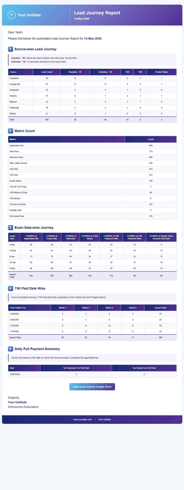
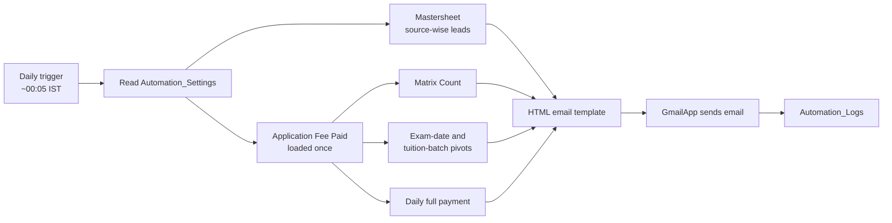

# Lead Journey Report Automation

A Google Apps Script automation that builds a daily admissions and revenue report from Google Sheets and emails it to the team as a branded HTML report, with no manual work.

*The screenshot uses dummy data. No real student or company data is included in this repository.*

## The problem

The admissions and finance teams tracked leads, payments and enrollments across several Google Sheets. Every morning someone had to filter the sheets by date, count leads and payments per source, build pivot tables and paste the numbers into an email. The work took hours, depended on one person, and small filter mistakes led to wrong numbers.

## The solution

A time-driven Apps Script runs every night (around 00:05 IST), reads the sheets, calculates every metric for the previous day and sends one HTML email to the leadership and sales teams.

- **End to end:** no person is needed to prepare or send the report.
- **About 50% less time** spent on daily reporting work.
- **Configurable from a sheet:** recipients, send time, sheet names, test date and branding are edited in an `Automation_Settings` tab, not in code.
- **Logged:** every run, success or failure, is written to an `Automation_Logs` tab with execution time and error details.

## How it works

The fee sheet is read **one time** and the same in-memory data is shared by three report services. This keeps each run fast and well inside Apps Script quotas.

## What the email contains

| # | Section | What it shows |
| --- | --- | --- |
| 1 | Source-wise Lead Journey | Leads, 1K, 15K, 75K and hostel token payments per lead source for the report date |
| 2 | Matrix Count | Funnel totals: applications, tests, interviews, offers, payments, refunds |
| 3 | Exam Date-wise Journey | Funnel counts grouped by exam date |
| 4 | 75K Paid Date Wise | Students who paid 75K, grouped by final tuition fee and batch |
| 5 | Daily Full Payment Summary | Students who completed semester or hostel fees on the report date |

## Project structure

| File | Purpose |
| --- | --- |
| `src/Code.gs` | Custom menu and the main `runLeadJourneyAutomation` flow |
| `src/Config.gs` | Defaults and reading `Automation_Settings` |
| `src/DataService.gs` | Loads the fee sheet once and shares it |
| `src/DashboardService.gs` | Source-wise lead journey from the master sheet |
| `src/MatrixService.gs` | Funnel matrix counts |
| `src/PivotService.gs` | Exam-date and tuition-batch pivots |
| `src/DailyFullPaidService.gs` | Daily full-payment summary |
| `src/MailService.gs` | Builds and sends the email, loads the optional logo |
| `src/HtmlBuilder.gs` | Renders the template and converts tables to HTML |
| `src/Email.html`, `src/Styles.html` | Email template and styles |
| `src/TriggerService.gs` | Install, remove and check the daily trigger |
| `src/Logger.gs` | Writes to `Automation_Logs` |
| `src/Utilities.gs` | Date parsing, header lookup, HTML escaping |

## Setup

1. Create a Google Sheet with the tabs and columns listed in [docs/SHEET_SETUP.md](docs/SHEET_SETUP.md).
2. Open **Extensions → Apps Script** and add each file from `src/` (`.gs` files as scripts, `.html` files as HTML).
3. Fill in the `Automation_Settings` tab (at minimum `Recipients`).
4. Reload the sheet. A **Lead Journey Automation** menu appears.
5. Set a `Test Date` and click **Send Test Report** to check the email.
6. Clear `Test Date` and click **Install Daily Trigger**.

You can also push the code with [clasp](https://github.com/google/clasp): `clasp create --type sheets`, then `clasp push` from the `src/` folder.

## Tech

Google Apps Script (V8), SpreadsheetApp, GmailApp, HtmlService templates, DriveApp, time-driven triggers.

## Author

Abhishek Kumar, Revenue Operations & Automation Analyst.
